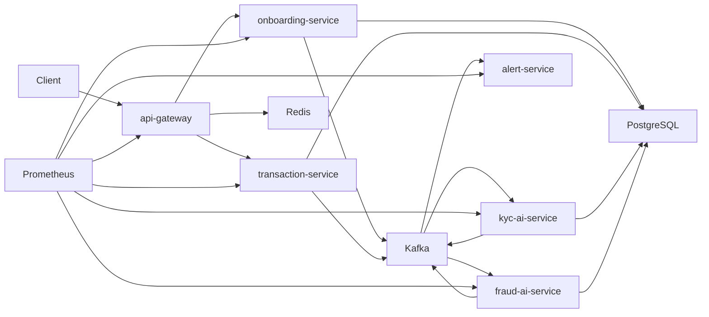

# Architecture Runbook

## Runtime Flow



1. Client calls `api-gateway`.
2. Gateway verifies JWT for protected routes, applies Redis rate limiting, and forwards with `x-correlation-id`.
3. `onboarding-service` persists users and KYC rows, then publishes `user.registered` and `document.uploaded`.
4. `kyc-ai-service` consumes `document.uploaded`, runs OCR/extraction, updates `kyc_results`, and publishes `user.kyc.completed`.
5. `transaction-service` persists transactions and publishes `txn.created`.
6. `fraud-ai-service` consumes `txn.created`, derives risk features, writes `fraud_scores`, and publishes `fraud.detected` when the threshold is crossed.
7. `alert-service` consumes `user.kyc.completed` and `fraud.detected`, then logs simulated notifications.

## Service Responsibilities

| Service | Owns | Publishes | Consumes |
| --- | --- | --- | --- |
| `api-gateway` | Auth boundary, rate limit, routing | - | - |
| `onboarding-service` | `users`, `kyc_results` intake | `user.registered`, `document.uploaded` | - |
| `transaction-service` | `transactions` | `txn.created` | - |
| `kyc-ai-service` | KYC extraction result updates | `user.kyc.completed` | `document.uploaded` |
| `fraud-ai-service` | `fraud_scores` | `fraud.detected` | `txn.created` |
| `alert-service` | Notification simulation | - | `user.kyc.completed`, `fraud.detected` |

## Database Ownership

This portfolio version uses one PostgreSQL database to keep local operations simple. The service boundaries are still explicit:

- Onboarding writes `users` and initial `kyc_results`.
- KYC AI updates existing KYC rows.
- Transaction writes `transactions`.
- Fraud AI writes `fraud_scores`.
- Shared tables such as `processed_events` support platform reliability.

## AI Training Handoff

Fraud training is intentionally outside the runtime path. After training, place the artifact at:

```text
models/fraud_isolation_forest.joblib
```

Or override:

```bash
FRAUD_MODEL_PATH=/absolute/path/to/fraud_isolation_forest.joblib
```

The expected features are:

```text
amount
time_since_last_txn
location_change_km
merchant_category_encoded
device_seen_before
txn_count_5min
```

Until a trained artifact exists, the runtime fallback scorer keeps the Kafka flow and database writes demonstrable.

## Observability

- Every FastAPI service exposes `/metrics`.
- Prometheus scrapes service metrics.
- Grafana provisions `infra/grafana/dashboards/banking-ai-overview.json`.
- `x-correlation-id` is propagated through gateway requests and Kafka events.
- Zipkin endpoint is configured through `ZIPKIN_ENDPOINT`.

## Docker Validation Later

When returning to Docker validation, use this order:

```bash
docker compose pull postgres redis zookeeper kafka
docker compose up -d postgres redis zookeeper kafka
docker compose up -d migration onboarding-service transaction-service api-gateway
docker compose up -d kyc-ai-service fraud-ai-service alert-service
docker compose up -d prometheus grafana zipkin
bash scripts/demo_flow.sh
```
